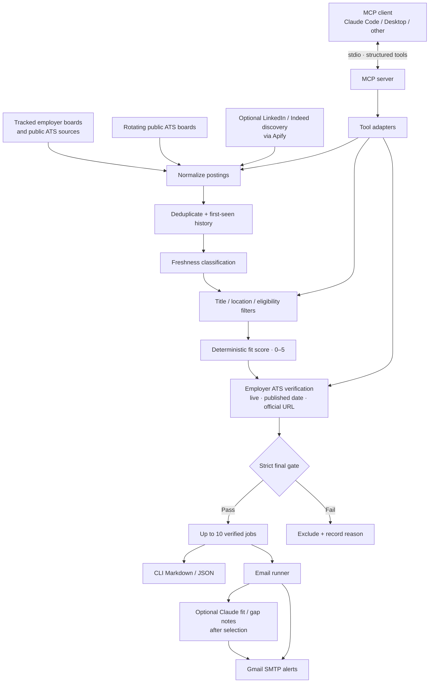

# job-radar-mcp

**Find genuinely new job openings, verify them at the employer, and make the workflow available to AI assistants through MCP.**

[Architecture](#architecture) · [MCP tools](#mcp-server-and-tools) · [Quick start](#quick-start) · [Engineering decisions](#engineering-decisions) · [Testing](#testing-and-reliability) · [Limitations](#current-status-and-limitations)

> **In brief:** This Node.js system scans public employer applicant-tracking systems (ATS), identifies roles first published within the last 24 hours, detects duplicates and reposts, evaluates profile-specific eligibility, and returns up to 10 verified opportunities with official application links. The same capabilities are available through a CLI, an optional email runner, and a local Model Context Protocol (MCP) server.

**Personal outcome:** I built this to stop repeatedly checking job boards and manually reviewing irrelevant or recycled listings. In my own workflow, it reduced repetitive job-search screening effort by an **estimated 80%**. That is a personal time-savings estimate, not a controlled performance benchmark.

## The problem

A job board saying *posted 1 hour ago* does not always mean an employer opened the position an hour ago. A listing may be refreshed, copied from another board, already closed, or incompatible with the applicant's requirements. Checking posting dates, official application links, sponsorship language, location, and duplicates by hand is slow.

**The goal:** prioritize **precision over volume**. If the system cannot establish that a posting is genuinely new and open on the employer's site, it does not fill the results with an unverified alternative.

## What the system does

| Capability | How it works | Why it matters |
|---|---|---|
| Employer-first verification | Reads supported public ATS listings and checks shortlisted postings on the employer's own system | Avoids relying on a job aggregator's refreshed timestamp |
| Freshness and repost detection | Compares employer publication evidence with a persistent first-seen history, IDs, canonical URLs, and content fingerprints | Reduces recycled alerts and duplicate manual review |
| Eligibility screening | Applies configurable rules for sponsorship, OPT, citizenship/clearance, experience, graduation, salary, and location | Filters clearly unsuitable postings; flags ambiguous language for review |
| Explainable fit scoring | Ranks candidates on a deterministic 0–5 scale | Keeps ranking inspectable and reproducible |
| Automated delivery | Formats results for CLI output and optional Gmail alerts | Avoids repeatedly checking multiple sites |
| AI assistant integration | Exposes three tools through an MCP server using the official TypeScript/JavaScript SDK | Makes the same workflow callable from an MCP-compatible assistant |
| Guardrails | Timeouts, concurrency limits, rate/cost caps, dry-run defaults, and a strict result gate | Bounds unattended work and unexpected API spending |

## Architecture



The diagram shows *logical capabilities*, not one monolithic request: the CLI and email runner call the scan engine, while MCP exposes the scan and two targeted checks through separate tool handlers. See [docs/ARCHITECTURE.md](docs/ARCHITECTURE.md) for the module-level design.

### Data flow, step by step

1. **Discover:** load configured employer boards, rotate through public ATS boards, and optionally use Apify for discovery.
2. **Normalize:** convert records from different sources into a consistent job model.
3. **Recognize prior listings:** match source IDs, requisition numbers, canonical URLs, company/title/location combinations, and near-identical descriptions against the first-seen store.
4. **Classify freshness:** distinguish `NEW`, `SEEN`, `POSSIBLE_REPOST`, `VERIFY`, and `STALE`.
5. **Screen and score:** apply hard filters, detect explicit disqualifiers, flag ambiguous text, and calculate a deterministic fit score.
6. **Verify at the employer:** confirm the posting is live, establish publication evidence, and retain an official application URL.
7. **Enforce the final gate:** return only qualifying jobs; explain why other candidates were excluded.
8. **Deliver:** render a report, optionally send an email, or return structured data to an MCP caller.

The system does **not** submit job applications or make visa eligibility determinations on anyone's behalf. Its screening is a configurable rule-based aid; applicants should check ambiguous requirements themselves.

## MCP server and tools

The MCP implementation is in [`src/mcp/server.mjs`](src/mcp/server.mjs). It uses `@modelcontextprotocol/sdk`, `zod` input schemas, and `StdioServerTransport`. Tool handlers live in [`src/tools.mjs`](src/tools.mjs). The MCP protocol uses stdout; diagnostics are written to stderr.

| Tool | Inputs | Returns | Side effects |
|---|---|---|---|
| **`run_scan`** | `preset`, `include_apify=false`, `dry_run=true` | Matching jobs, exclusions, runtime, optional paid-source spend | A non-dry run can update first-seen state |
| **`check_job_link`** | Employer ATS `url`, optional `title` | Supported ATS, whether the posting is live, publication time/age when available, eligibility, fit | Reads a public employer posting; does not modify state |
| **`check_eligibility`** | Job `description`, optional `title` | `OK` / `VERIFY` / `BLOCKED`, reasons, skills, score | Offline, read-only |

**Why three tools?** An assistant can answer a narrow question without launching a full scan. For example, it can analyze pasted job text offline, verify one employer link, or scan a selected group of boards.

**Safety defaults:**

- `run_scan` defaults to `dry_run=true` and `include_apify=false`.
- Paid Apify discovery is available to MCP only when **both** the server starts with `RADAR_MCP_ALLOW_APIFY=1` **and** the tool call requests `include_apify=true`. Per-scan limits still apply.
- The MCP server cannot apply to jobs or send email through these tools.
- The eligibility tool does not make network requests. A posting link must be on a supported employer ATS to be checked by `check_job_link`.
- Input validation is defined with Zod; tool results return JSON-compatible structured content.

### Use it with an MCP client

First install dependencies as shown in [Quick start](#quick-start). Then register the server using the **absolute path on your machine**:

```bash
claude mcp add job-radar -- node /absolute/path/to/job-radar-mcp/src/mcp/server.mjs
```

For Windows PowerShell, for example, when cloned to `D:\Projects\job-radar-mcp`:

```powershell
claude mcp add job-radar -- node "D:\Projects\job-radar-mcp\src\mcp\server.mjs"
```

An MCP client can then request:

```text
Use check_eligibility on this job description and explain any BLOCKED or VERIFY findings.

Check whether this employer ATS job URL is live and first posted within 24 hours.

Run a free, dry-run scan for new jobs. Do not use paid sources or change saved state.
```

For a concrete offline test, [`tests/mcp.test.mjs`](tests/mcp.test.mjs) starts the **real MCP server** with an official SDK client, discovers all three tools, and invokes `check_eligibility` on sample job text. This checks more than a mock function call: it exercises the protocol connection.

## Engineering decisions

### 1. Deterministic rules decide what qualifies

The scanner does not ask an LLM whether a posting is new, live, eligible, or well matched. Those decisions are made with explicit rules and fixed scoring weights:

| Signal | Weight |
|---|---:|
| Job title | 40% |
| Skills | 30% |
| Seniority / experience | 15% |
| Location | 10% |
| Salary | 5% |

A Claude-powered one-line **fit / gap** explanation is **optional and runs only after selection** for email alerts. It cannot add, remove, or reorder jobs. If that optional step fails, the email runner can continue without AI notes. See [ADR 0003](docs/adr/0003-llm-only-for-judgment.md).

### 2. No evidence means no result

The final shortlist requires an employer-supported recent publication date, a live posting, an official application link, and no hard eligibility block. Listings with missing original publication evidence do not pass merely because an aggregator shows a fresh label.

The system may miss legitimate openings when an employer provides insufficient evidence. This is an intentional **precision-over-recall** tradeoff.

### 3. State makes repost detection possible

[`src/engine/seen-store.mjs`](src/engine/seen-store.mjs) maintains first-seen records and checks strong identifiers as well as approximate description similarity. It retains recent observations for a rolling 180-day window. A job refreshed on a third-party board should not be presented as a brand-new opportunity solely because its displayed age changed.

### 4. Fail safely and bound work

| Limit or behavior | Implemented design |
|---|---|
| Source collection budget | 90 seconds |
| Soft / hard scan limits | 3 minutes / 5 minutes |
| Source workers | Up to 3 in parallel |
| HTTP concurrency | Up to 8 requests |
| Results | Up to 10 jobs; never padded with unverified roles |
| Optional Apify discovery | Default scan cap $0.10; hard configurable ceiling $0.25 |
| Email failure | Keep selected alerts pending for a later send attempt |
| Optional Claude failure | Continue without explanatory notes |

The limits are enforced in the engine rather than trusted to callers. See [docs/GUARDRAILS.md](docs/GUARDRAILS.md) and [`src/engine/config.mjs`](src/engine/config.mjs).

## Quick start

**Requirements:** Node.js **20+**, npm, Git. A free scan needs no Gmail, Apify, or Anthropic credentials; network access is needed to query employer sources.

### macOS / Linux / Git Bash

```bash
git clone https://github.com/Yogananda16/job-radar-mcp.git
cd job-radar-mcp
npm ci

# Use the example configuration for a reproducible setup.
cp config/profile.example.yml config/profile.yml
cp config/portals.example.yml config/portals.yml

npm test
npm run scan -- --no-apify --dry-run
```

### Windows PowerShell

```powershell
git clone https://github.com/Yogananda16/job-radar-mcp.git
cd job-radar-mcp
npm ci

Copy-Item config/profile.example.yml config/profile.yml -Force
Copy-Item config/portals.example.yml config/portals.yml -Force

npm test
npm run scan -- --no-apify --dry-run
```

The dry run prints a Markdown report with either qualifying roles or exclusion counts explaining why none passed. **Zero results is valid** when no job meets the strict freshness and verification rules. It does not imply the scanner is broken.

Edit `config/profile.yml` for roles, skills, location preferences, salary, and eligibility. Edit `config/portals.yml` for tracked employers and filters. See [Configuration reference](docs/CONFIGURATION.md). Do not commit real personal configuration to a public fork.

### Common commands

```bash
npm run scan -- --no-apify --dry-run     # One free scan; no saved changes
npm run scan -- faang --no-apify --dry-run # Company preset
npm run scan -- --no-apify --dry-run --json # Machine-readable output
npm run alert -- --dry-run               # Preview an email; do not send
npm run mcp                              # Start MCP stdio server for a client
npm test                                 # Offline tests
npm run check                            # Secret-pattern scan + tests
```

Starting `npm run mcp` directly may look idle: it is a **stdio protocol server**, not a website or terminal chat. Connect it through an MCP client as shown above.

### Optional email alerts

Copy `.env.example` to `.env` and configure `GMAIL_USER` and `GMAIL_APP_PASSWORD` (a Gmail App Password, not your normal login password). `ALERT_TO` is optional. Then:

```bash
npm run test-email              # Sends a sample message
npm run alert -- --dry-run      # Preview without sending or changing state
npm run alert                  # Run once, send qualifying alerts, save state
```

Apify discovery requires `APIFY_TOKEN` and an explicit paid-mode choice; optional Claude explanations require `ANTHROPIC_API_KEY`. **A single `npm run alert` is not a background scheduler.** Use your own scheduler or configure a private GitHub Actions workflow if you want recurring runs.

## Testing and reliability

The repository contains offline tests for freshness and repost handling, provider integration, eligibility rules, deterministic scoring, presets and limits, diagnostics, email/alert behavior, and MCP protocol interactions.

- **Run locally:** `npm test`.
- **Run tests plus secret-pattern checks:** `npm run check`.
- **CI configuration:** [`.github/workflows/ci.yml`](.github/workflows/ci.yml) runs checks on Node.js 20, 22, and 24 for pushes and pull requests.
- **MCP integration test:** [`tests/mcp.test.mjs`](tests/mcp.test.mjs) starts a server and invokes a tool over stdio.

Tests exercise logic and mocked external responses; they are **not** proof that every external job board is reachable or that a live scheduled deployment is healthy. Confirm any current CI status from the repository's [Actions page](https://github.com/Yogananda16/job-radar-mcp/actions).

### A three-minute technical walkthrough

1. **Problem:** show why a refreshed job-board listing is different from a genuinely new employer posting.
2. **Architecture:** trace one job from source → normalization → first-seen history → eligibility and score → employer verification → final results.
3. **MCP:** open [`src/mcp/server.mjs`](src/mcp/server.mjs), show the three registered tools and Zod schemas, then open [`tests/mcp.test.mjs`](tests/mcp.test.mjs).
4. **Guardrails:** explain why paid scans and persistent state writes are disabled by default in MCP.
5. **Validation:** run `npm test`, then a free dry run, and discuss why no results can be a correct outcome.

## Repository map

```text
src/
  engine/          Discovery, normalization, deduplication, freshness,
                   eligibility, scoring, employer verification, limits
  mcp/server.mjs   MCP server and registered tool definitions
  tools.mjs        Plain-data adapters called by MCP tools
  alerts/          Sent/pending alert tracking
  notify/          Email rendering and Gmail SMTP delivery
  ai/              Optional post-selection Claude explanations
  vendor/          Adapted ATS providers and shared utilities
config/            Example profiles, tracked boards, discovery settings
tests/             Offline rule and MCP integration tests
docs/              Architecture, design decisions, guardrails, deployment notes
state/             First-seen records and runtime state (handle privately)
.github/workflows/ci.yml  Build/test checks
```

## Current status and limitations

- **Available in this repository:** the implemented CLI scan engine, MCP server, optional email runner, test suite, and CI *configuration*. These components still need to be executed and verified in each environment.
- **Scheduling:** the public repository currently includes `ci.yml` but **does not include** `.github/workflows/scan.yml`. Recurring GitHub-hosted scans are **not configured in this public snapshot**, even though some older design/deployment documents describe that workflow.
- **Not a guarantee of complete coverage:** employers may omit reliable publication timestamps, restrict access, change their APIs, or publish ambiguous eligibility wording. The scanner deliberately favors verified results over an exhaustive list.
- **Not an autonomous applicant:** there is no automatic job application or account login workflow.
- **Not a financial/legal eligibility decision-maker:** sponsorship and other eligibility flags are text-based heuristics for human review.
- **Impact metric:** the stated ~80% reduction is a personal estimate of manual screening effort, not an independently measured benchmark.
- **Personal data:** do not publish working job-search profiles, email credentials, or job-history state. `.gitignore` does not remove files already tracked in git; review `config/` and `state/` before publishing or sharing a fork.

## Documentation

| Document | Details |
|---|---|
| [Architecture](docs/ARCHITECTURE.md) | Components, pipeline, job lifecycle, MCP implementation |
| [Design](docs/DESIGN.md) | Goals, non-goals, tradeoffs |
| [Guardrails](docs/GUARDRAILS.md) | Time, spend, concurrency, security, correctness and failure behavior |
| [Configuration](docs/CONFIGURATION.md) | Profile and source configuration |
| [Sources](docs/SOURCES.md) | Provider capabilities and origin of listings |
| [Costs](docs/COST.md) | Optional paid discovery and AI note estimates |
| [Troubleshooting](docs/TROUBLESHOOTING.md) | Common local and runtime problems |
| [Architecture decisions](docs/adr/) | Why key technical choices were made |
| [Changelog](CHANGELOG.md) | Versions and changes |
| [Security](SECURITY.md) | Security model and vulnerability reporting |

## Attribution and license

This standalone project grew from a personal adaptation of [career-ops](https://github.com/santifer/career-ops) by Santiago Fernández de Valderrama. Parts of the ATS provider layer in `src/vendor/` are adapted from that MIT-licensed project; see [`src/vendor/LICENSE-career-ops`](src/vendor/LICENSE-career-ops). Public ATS board datasets also draw from [job-board-aggregator](https://github.com/Feashliaa/job-board-aggregator).

Other major parts of this repository include the profile-driven scan pipeline, first-seen behavior, email runner, MCP interface, tests, and related documentation. Review the source and commit history for individual contributions. Licensed under [MIT](LICENSE).
