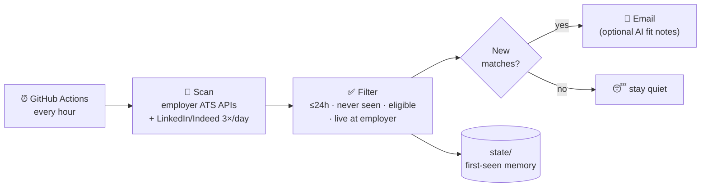
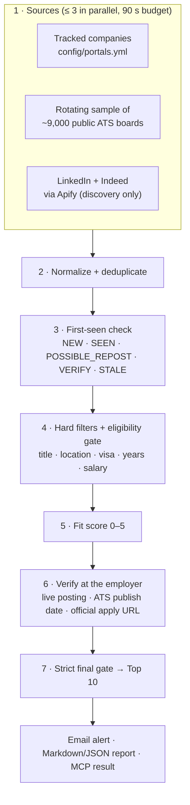

# job-radar

**Hourly email alerts for jobs posted in the last 24 hours that match your profile.** Every job is confirmed live on the employer's own careers site, reposts never come through, and the apply link always goes to the employer.

[](https://github.com/Yogananda16/job-radar/actions/workflows/ci.yml)




---

## Why

Job boards show a job as "posted 1 hour ago" when it was only *refreshed*. The real posting may be weeks old, filled, or a duplicate. Applying early matters, but only to jobs that really are new.

job-radar asks the employer instead of the board. It reads the posting date from the employer's own applicant tracking system (Greenhouse, Lever, Ashby, Workday, …), remembers every job it has seen, and emails you only jobs that are new, eligible for you, and open right now.

## Features

- **Truly fresh.** A job qualifies only if the *employer's* system says it was first posted ≤ 24 hours ago. A board's "just posted" label never counts.
- **No reposts.** A first-seen memory (job id, URL, requisition number, text fingerprint) stops refreshed or re-released postings.
- **Verified links.** Each job must be live on the official careers page during the scan, and the Apply button links there, never to an aggregator.
- **Eligibility gate.** Hard filters for visa sponsorship, citizenship and clearance, years of experience, graduation date and salary floor. Unclear wording is marked **VERIFY**, never silently dropped or passed.
- **Fit score.** 0–5, deterministic: title 40%, skills 30%, seniority 15%, location 10%, salary 5%.
- **Cheap and bounded.** Employer APIs are free. Optional LinkedIn/Indeed discovery through Apify has a hard $0.10 cap per scan. Every scan stops at 5 minutes.
- **Runs itself.** A GitHub Actions schedule runs it in the cloud, so your computer can be off.
- **Agent-ready.** An MCP server lets Claude Code, Claude Desktop or Cursor call the scanner as tools.
- **Optional AI notes.** A short "why you fit / main gap" note per job, from Claude. It runs only on the final shortlist and never decides what you see.

## How it works



The full design is in [docs/ARCHITECTURE.md](docs/ARCHITECTURE.md) and [docs/DESIGN.md](docs/DESIGN.md).

## Quick start (local, 5 minutes)

**Requirements:** Node.js 20+ and git.

```bash
git clone https://github.com/Yogananda16/job-radar.git
cd job-radar
npm install

cp config/profile.example.yml config/profile.yml   # your roles, skills, visa rules
cp config/portals.example.yml config/portals.yml   # companies to watch
cp .env.example .env                               # secrets (only what you use)

npm run scan -- --no-apify --dry-run               # free test scan, saves nothing
```

You get a Markdown table of fresh, verified jobs (or a clear "nothing passed" line with counts of what was excluded and why).

On Windows PowerShell, use `copy` instead of `cp`.

## Get email alerts

```bash
# 1. Put GMAIL_USER and GMAIL_APP_PASSWORD in .env (see docs/DEPLOYMENT.md)
npm run test-email                 # sends a sample alert

# 2. Real run: scan, then email anything new
npm run alert                      # free sources only
npm run alert -- --apify           # also LinkedIn/Indeed (≤ $0.10)
npm run alert -- --dry-run         # print the email instead of sending it
```

## Run it every hour on GitHub (free)

1. Click **Use this template** → create a **private** repository from it.
2. In your copy, add your config: `git add -f config/profile.yml config/portals.yml`, then commit and push.
3. Add secrets (**Settings → Secrets and variables → Actions**): `GMAIL_USER`, `GMAIL_APP_PASSWORD`, plus optionally `ALERT_TO`, `APIFY_TOKEN`, `ANTHROPIC_API_KEY`.
4. Add the variable `RADAR_ENABLED` = `true`.
5. **Actions → scan → Run workflow** once to test.

After that it runs hourly for free (employer boards), plus 3 times a day with LinkedIn/Indeed if you added `APIFY_TOKEN`. Full step-by-step guide: [docs/DEPLOYMENT.md](docs/DEPLOYMENT.md).

## Use it from an AI agent (MCP)

```bash
claude mcp add job-radar -- node /absolute/path/to/job-radar/src/mcp/server.mjs
```

| Tool | What it does |
|---|---|
| `run_scan` | One scan with any preset. Dry run and free sources by default. |
| `check_job_link` | Is this posting live? When was it first posted? Am I eligible? |
| `check_eligibility` | Eligibility and fit for pasted job text (offline). |

An agent cannot start a paid scan unless you start the server with `RADAR_MCP_ALLOW_APIFY=1`. Details: [docs/ARCHITECTURE.md#8-mcp-server](docs/ARCHITECTURE.md#mcp-server).

## Commands

| Command | Purpose |
|---|---|
| `npm run scan -- [preset] [flags]` | One scan, printed as a table |
| `npm run alert -- [--apify] [--dry-run] [--preset X]` | Scan + email new matches |
| `npm run test-email` | Check Gmail settings |
| `npm run mcp` | Start the MCP server (stdio) |
| `npm test` | Run the test suite (~200 tests, no network) |
| `npm run check` | Secret scan + tests (what CI runs) |

**Presets:** `run` (default) · `faang` · `staffing` · `startup` · `remote` · `local` · `company <name>`, plus any you define in `profile.yml`.
**Flags:** `--no-apify` (free) · `--dry-run` (save nothing) · `--json` · `--tracked` · `--rotation-batch=N` · `--probe`.

## Cost

| Setup | Monthly cost |
|---|---|
| Hourly scans, employer boards only | **$0** |
| + LinkedIn/Indeed 3×/day | **≈ $5** (capped at $0.10 per scan) |
| + AI notes on each alert | ≈ $0.08 per alert email with `claude-opus-5-5`, ≈ $0.002 with `claude-haiku-5-5` |
| GitHub Actions (private repo) | $0 (≈ 900 of 2,000 free minutes) |

Worked examples and how to lower it further: [docs/COST.md](docs/COST.md).

## Documentation

| Document | Contents |
|---|---|
| [ARCHITECTURE.md](docs/ARCHITECTURE.md) | Components, data flow, job lifecycle, module map, diagrams |
| [DESIGN.md](docs/DESIGN.md) | Problem, goals and non-goals, requirements, key decisions |
| [GUARDRAILS.md](docs/GUARDRAILS.md) | Time, cost, concurrency and correctness limits, and what happens at each |
| [CONFIGURATION.md](docs/CONFIGURATION.md) | Every option in `profile.yml` and `portals.yml` |
| [DEPLOYMENT.md](docs/DEPLOYMENT.md) | Gmail, secrets, GitHub Actions, local scheduling |
| [SOURCES.md](docs/SOURCES.md) | Every job source, how it is read, and its limits |
| [COST.md](docs/COST.md) | Cost model and worked examples |
| [TROUBLESHOOTING.md](docs/TROUBLESHOOTING.md) | Common problems and fixes |
| [adr/](docs/adr/) | Architecture Decision Records |

## Project status

v0.1. The scan engine has been in daily personal use (ported from a private setup). Alerts, GitHub Actions and MCP are new in this repository. See [CHANGELOG.md](CHANGELOG.md).

## Responsible use

job-radar reads public job APIs and feeds at a low rate, identifies itself in its User-Agent, and skips sites whose terms prohibit automated access (it does not log in anywhere). LinkedIn/Indeed results come through Apify actors; check that your use complies with their terms. Applying is always your decision: job-radar never submits anything.

## Credits

The scan engine started inside [career-ops](https://github.com/santifer/career-ops) by Santiago Fernández de Valderrama (MIT). The ATS provider modules in `src/vendor/` are adapted from it. Public ATS board lists come from [job-board-aggregator](https://github.com/Feashliaa/job-board-aggregator).

## License

[MIT](LICENSE)
