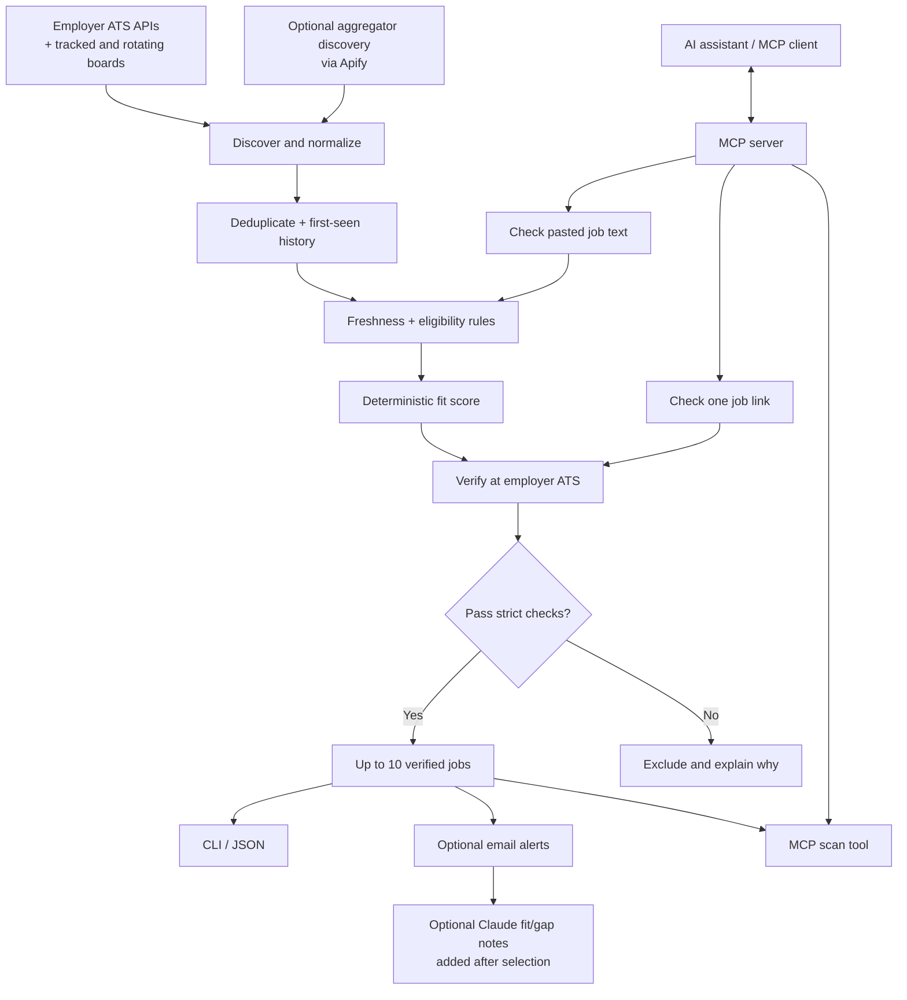

# job-radar-mcp

**A job-discovery engine with an MCP interface: find newly posted roles, verify them at the employer, and cut repetitive job screening.**

[How it works](#how-it-works) · [Architecture](#architecture) · [Documentation](#documentation) · [MCP tools](#mcp-server) · [Engineering decisions](#engineering-decisions) · [Testing](#testing-and-current-status)

## Why I built it

I was spending too much time reopening job boards, checking whether supposedly new jobs were reposts, reading eligibility requirements, and following links that sometimes led to expired postings.

**job-radar-mcp automates those checks.** In my personal job-search workflow, it reduced repetitive manual screening effort by **approximately 80%** (my estimate, not a controlled benchmark).

Instead of prioritizing the *number* of jobs returned, the system prioritizes trustworthy results: a posting must be demonstrably recent, open on an employer's own system, and linked to the official application page.

## At a glance

| | |
|---|---|
| **Outcome** | ~80% less manual screening effort in personal use (estimated) |
| **Freshness rule** | Employer-supported publication date within the past 24 hours |
| **Output** | Up to 10 verified openings per scan; no filler results |
| **AI integration** | 3 MCP tools callable by compatible AI assistants |
| **Interfaces** | CLI report, optional email alerts, local MCP server |
| **Stack** | Node.js, JavaScript ES modules, MCP SDK, Zod, public ATS APIs, optional Claude and Apify |

## How it works

1. **Discover** openings from tracked employers, rotating public applicant-tracking-system (ATS) boards, and optionally third-party discovery sources.
2. **Normalize and deduplicate** jobs from different providers, matching IDs, requisition numbers, URLs, and near-identical descriptions.
3. **Check freshness** against employer publication evidence and persistent first-seen history. A refreshed listing is not automatically a new job.
4. **Screen eligibility** using configurable rules for sponsorship, OPT, citizenship/clearance, experience, location, and salary. Ambiguous language is marked for human review.
5. **Score fit** from 0 to 5 using fixed, explainable weights.
6. **Verify at the employer** that the posting is still live and that the application link is official.
7. **Return only qualifying roles** through a report, optional email, or an MCP tool response. Excluded jobs are counted by reason.

**Design principle:** if there is not enough evidence that a job is genuinely new and open, the system excludes it instead of guessing. It never applies for jobs on the user's behalf.

## Architecture

The scan engine is shared by the CLI, alert runner, and MCP adapters. **Claude does not choose which jobs qualify**: optional AI-generated fit/gap notes are added only after rule-based selection.

## Documentation

For a deeper technical review, start here:

| Guide | What's inside |
|---|---|
| **[System architecture](docs/ARCHITECTURE.md)** | Modules, complete data flow, job lifecycle, MCP integration |
| **[Engineering design](docs/DESIGN.md)** | Requirements, tradeoffs, precision-over-recall decisions |
| **[Safety and guardrails](docs/GUARDRAILS.md)** | Time limits, cost ceilings, data handling, failure behavior |
| **[Configuration](docs/CONFIGURATION.md)** | Profile rules, employers, presets, eligibility checks |
| **[Architecture decisions](docs/adr/)** | Why employer ATS data, deterministic scoring, and persistent state were chosen |
| [Testing and troubleshooting](docs/TROUBLESHOOTING.md) | Diagnosing scan, provider, and configuration issues |
| [Sources](docs/SOURCES.md) · [Costs](docs/COST.md) · [Deployment](docs/DEPLOYMENT.md) | Source details, optional expenses, and setup |

## MCP server

The local [MCP server](src/mcp/server.mjs) uses the official Model Context Protocol SDK, **Zod input schemas**, and **stdio transport**. Its tool adapters are in [`src/tools.mjs`](src/tools.mjs). AI assistants such as Claude Code can call the project's capabilities through these tools.

| Tool | What an AI assistant can ask | Behavior |
|---|---|---|
| **`run_scan`** | “Find recent AI engineering roles that match my profile.” | Runs a configured scan and returns jobs, exclusion counts, runtime, and cost. **Dry run and free sources by default.** |
| **`check_job_link`** | “Is this employer's job posting live and actually new?” | Checks a supported employer ATS URL, posting age (when available), eligibility, and fit. |
| **`check_eligibility`** | “Does this job description have requirements that block me?” | Evaluates pasted text **offline** and returns `OK`, `VERIFY`, or `BLOCKED` with supporting details. |

### Example: the difference between an agent and the tools

An MCP-connected assistant can reason about *which check to perform*, but the code supplies the result:

> **User:** “Can I apply for this role, and is it still open?”
>
> **Assistant:** Calls `check_job_link` for the employer's URL.
>
> **Tool:** Returns the posting's live status, employer publication evidence, eligibility checks, and fit score.
>
> **Assistant:** Explains the findings, including anything that needs human verification.

The MCP server **does not submit applications or send emails**. A full scan may record first-seen state when explicitly requested with `dry_run=false`; otherwise the default is non-persistent. Paid Apify discovery requires both an opt-in environment setting and an explicit request in the tool call.

**Code to inspect:** [`src/mcp/server.mjs`](src/mcp/server.mjs) · [`src/tools.mjs`](src/tools.mjs) · [`tests/mcp.test.mjs`](tests/mcp.test.mjs)

## Engineering decisions

### 1. Employer websites are the source of truth

A third-party board might show “posted 1 hour ago” for an older or republished job. The final result is gated on employer-supported freshness, a live official page, and an official application URL. This improves precision, even if it means missing some legitimate jobs whose dates cannot be verified.

### 2. The core is deterministic; AI is optional

Rules decide freshness, deduplication, eligibility, and ranking. The **0–5 fit score** uses title (40%), skills (30%), seniority (15%), location (10%), and salary (5%).

Optional Claude integration writes a short “why it fits / main gap” note **only after** the shortlist exists. A model error or missing API key cannot silently change the shortlist or prevent an otherwise valid alert.

### 3. The system remembers what it has seen

A persistent first-seen store uses job IDs, canonical URLs, requisition numbers, company/title/location combinations, and text fingerprints to detect repeats. Its rolling history helps prevent old listings from resurfacing as “new” after a board refresh.

### 4. Safe defaults for unattended and agent-triggered tasks

| Protection | Implemented behavior |
|---|---|
| **No accidental paid scan** | MCP paid discovery requires two explicit opt-ins; Apify spending is capped |
| **No accidental state update** | MCP scans default to `dry_run=true` |
| **Time and load bounds** | 90-second collection budget; 3-minute soft / 5-minute hard scan limits; limited concurrency |
| **Explainable exclusions** | Unverified freshness, closed listings, duplicates, and hard eligibility conflicts are not padded into results |
| **Failure handling** | Optional AI notes can be skipped; unsent email alerts can be retained for retry |
| **Untrusted job text** | Posting content is handled as data, not instructions to the agent or application |

The full enforcement rules are in [GUARDRAILS.md](docs/GUARDRAILS.md).

## Testing and current status

The repository has automated tests for freshness, repost detection, eligibility, source matching, scoring, time/cost limits, alert behavior, and MCP interactions.

Of particular interest, the [MCP integration test](tests/mcp.test.mjs) starts a **real MCP server** over stdio, discovers all three tools, and calls `check_eligibility` using an MCP client. CI configuration runs tests and secret-pattern checks across Node.js 20, 22, and 24.

**Current snapshot:** this public repository contains the implementation and [CI workflow](.github/workflows/ci.yml), but **not an active scheduled-scan workflow**. Some older documents describe an hourly `scan.yml`; that workflow is not present in this copy. Test and deployment status should be verified in [GitHub Actions](https://github.com/Yogananda16/job-radar-mcp/actions) rather than assumed from this README.

### Where to start reviewing the code

- [`src/engine/run.mjs`](src/engine/run.mjs): the end-to-end scan pipeline and final decision gate.
- [`src/engine/freshness.mjs`](src/engine/freshness.mjs) and [`seen-store.mjs`](src/engine/seen-store.mjs): fresh-versus-reposted logic.
- [`src/engine/eligibility.mjs`](src/engine/eligibility.mjs): rule-based screening and reasons.
- [`src/mcp/server.mjs`](src/mcp/server.mjs) and [`src/tools.mjs`](src/tools.mjs): MCP interface and tool handlers.
- [`tests/mcp.test.mjs`](tests/mcp.test.mjs): protocol-level MCP test.

**Want to run it?** See [Deployment](docs/DEPLOYMENT.md). At minimum, the project uses Node.js 20+; `npm test` exercises the offline tests, and `npm run scan -- --no-apify --dry-run` performs a free, non-persistent scan. No credentials are needed for the free scan.

## Limitations and responsible use

- Not all employer systems provide verifiable publication timestamps. Missing evidence can lead to deliberately excluded results.
- Eligibility screening is a rule-based aid, **not** legal or immigration advice; ambiguous requirements still need human review.
- This is not a job-application bot and does not log into job sites to apply.
- The **~80% time saving** is an estimate from personal use, not an independently validated metric.
- Public copies must exclude private profiles, credentials, and runtime history. `.gitignore` alone does **not** remove previously tracked files; review `config/` and `state/` before sharing.

## Attribution and license

The original scan engine was developed within a personal adaptation of [career-ops](https://github.com/santifer/career-ops) by Santiago Fernández de Valderrama. Some ATS provider modules and utilities in [`src/vendor/`](src/vendor/) are adapted under the MIT license; see [upstream attribution](src/vendor/LICENSE-career-ops). Public ATS board data is also sourced in part from [job-board-aggregator](https://github.com/Feashliaa/job-board-aggregator).

This repository is distributed under the [MIT License](LICENSE).
