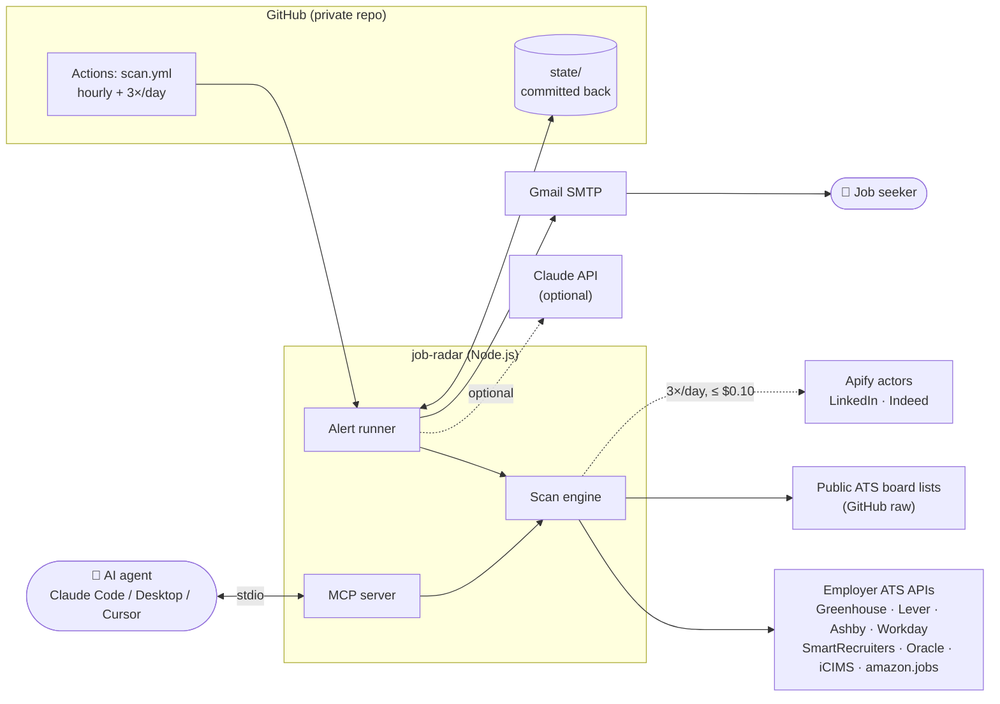
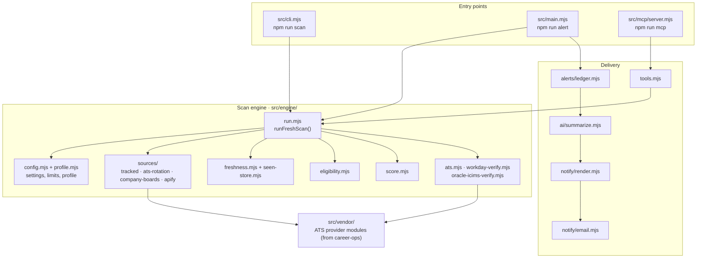
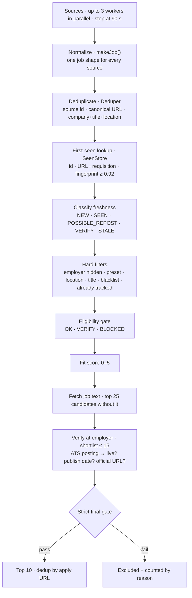
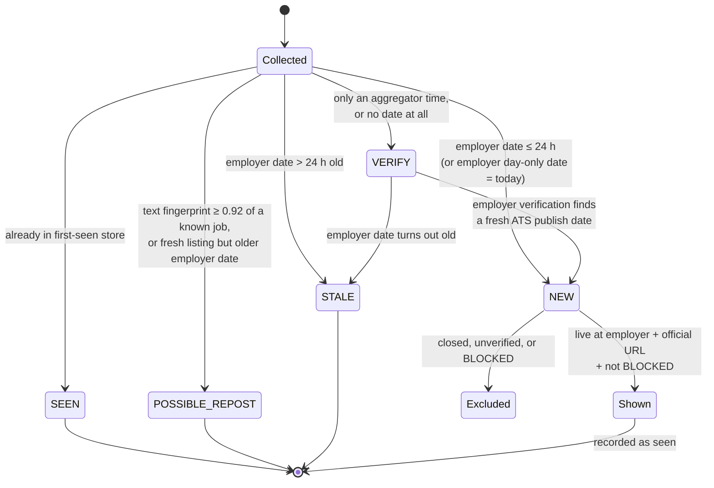
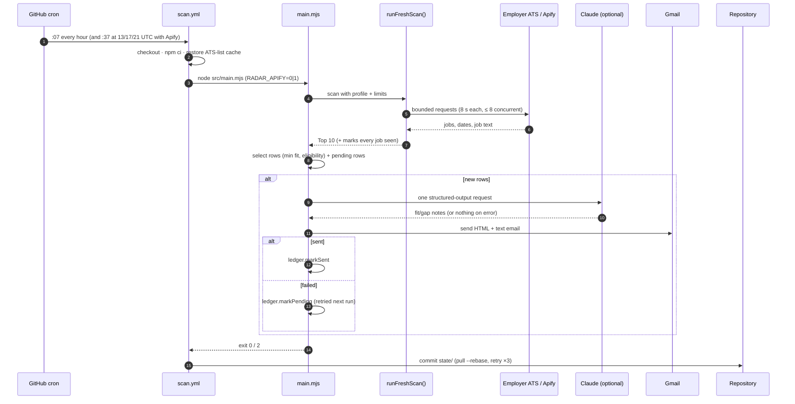

# Architecture

This document describes how job-radar is put together: the components, how data moves through them, where state lives, and how to extend it. For *why* it is built this way, see [DESIGN.md](DESIGN.md) and the [ADRs](adr/).

- [1. System context](#1-system-context)
- [2. Components](#2-components)
- [3. The scan pipeline](#3-the-scan-pipeline)
- [4. Job lifecycle (freshness states)](#4-job-lifecycle-freshness-states)
- [5. One scheduled run, end to end](#5-one-scheduled-run-end-to-end)
- [6. State and files](#6-state-and-files)
- [7. Module map](#7-module-map)
- [8. MCP server](#8-mcp-server)
- [9. Extending job-radar](#9-extending-job-radar)

---

## 1. System context



| External system | Used for | Auth | Cost |
|---|---|---|---|
| Employer ATS APIs | Job lists, posting dates, job text, live checks | none (public) | free |
| Public ATS board lists | ~9,000 boards for the rotating sample | none | free |
| Apify | LinkedIn/Indeed discovery (never the apply link) | `APIFY_TOKEN` | ≤ $0.10 per scan |
| Claude API | Optional fit/gap notes in the email | `ANTHROPIC_API_KEY` | per alert, see [COST.md](COST.md) |
| Gmail SMTP | Sending alerts | `GMAIL_USER` + App Password | free |
| GitHub Actions | Scheduling, secrets, state storage | repo secrets | free tier |

## 2. Components



| Component | Responsibility | Deterministic? |
|---|---|---|
| **Scan engine** (`src/engine/`) | Collect, deduplicate, classify, filter, score and verify jobs. Returns the Top 10. | Yes, no LLM |
| **Alert runner** (`src/main.mjs`) | Run a scan, pick rows worth an email, retry failed sends, call the optional AI layer, send, record. | Yes, except the optional AI notes |
| **AI layer** (`src/ai/`) | One structured-output call per alert for "fit / gap" notes. | No, and it is never on the decision path |
| **Notifier** (`src/notify/`) | Render HTML/text email; send through Gmail SMTP. | Yes |
| **MCP server** (`src/mcp/`) | Expose scan, link check and eligibility check as tools for agents. | Yes |
| **Vendored providers** (`src/vendor/`) | Read each ATS's public API into one job shape. | Yes |

## 3. The scan pipeline

`runFreshScan(options)` in `src/engine/run.mjs` is the whole pipeline as one async function. Every entry point calls it.



**Stage notes**

1. **Sources** run as independent workers (max 3, see [GUARDRAILS.md](GUARDRAILS.md)). Each emits jobs as it finds them, so a slow source never blocks a fast one. At 90 s all sources stop and the pipeline continues with what it has.
2. **Normalize.** `makeJob()` (`job.mjs`) gives every job the same fields: `source`, `url`, `employerUrl`, `company`, `title`, `location`, `postedAt` + `postedEvidence`, `listedAt`, `description`, `requisitionId`, `liveVerified`.
3. **Deduplicate.** The same posting from two sources merges into one record that keeps the best evidence from each (`mergeJobs`).
4. **First-seen lookup.** `SeenStore` (`seen-store.mjs`) holds every job seen in the last 180 days under several keys. A match pins the job to its *original* first-seen time.
5. **Freshness.** `classifyFreshness()` decides the state (next section).
6. **Hard filters** only remove jobs. They are counted by reason in the report.
7. **Eligibility** (`eligibility.mjs`) applies the profile's rules to the job text and quotes the sentence that triggered each finding.
8. **Fit score** (`score.mjs`): title 40% · skills 30% · seniority 15% · location 10% · salary 5%, minus 0.5 per soft flag (internship, contract, senior 5+ years).
9. **Job text** is fetched from the ATS only for the top 25 candidates that arrived without it.
10. **Employer verification** (`ats.mjs`, `workday-verify.mjs`, `oracle-icims-verify.mjs`) finds the posting on the employer's own system. It replaces an aggregator's date with the employer's publish date, confirms the posting is open, and records the official URL. Ambiguous matches (two equally good postings) are rejected rather than guessed.
11. **Strict final gate** (`finalGateReason()`): see [GUARDRAILS.md § Correctness](GUARDRAILS.md#correctness-guardrails).

The result object contains `top` (the rows), `counts` (collected, evaluated, excluded-by-reason, age breakdown), `failures` (per-board errors), `sources` (per-source stats), `apify` (spend), and timing.

## 4. Job lifecycle (freshness states)



| State | Meaning | Can be shown? |
|---|---|---|
| `NEW` | Employer says first posted ≤ 24 h ago, never seen before | Yes, if it also passes the final gate |
| `SEEN` | Known to the first-seen store | Never |
| `POSSIBLE_REPOST` | Near-identical to a known job, or the listing is fresh but the employer date is old | Never |
| `VERIFY` | Freshness can't be proven (aggregator time only, no date) | Never; employer verification may upgrade it |
| `STALE` | Employer date is older than 24 h | Never |

## 5. One scheduled run, end to end



Runs never overlap (`concurrency: scan`), so two runs can't race on `state/`.

## 6. State and files

| Path | Written by | Contents | In git? |
|---|---|---|---|
| `config/profile.yml` | you | Roles, skills, locations, salary, eligibility, alerts, AI, scan settings | private copy only |
| `config/portals.yml` | you | Tracked companies, title and location filters | private copy only |
| `config/cv.md` | you (optional) | Skills source when `profile.yml` has no `skills:` | private copy only |
| `config/blacklist.md` | you (optional) | Do-not-apply companies/domains | private copy only |
| `state/job-seen.json` | engine | First-seen store (180-day window) | committed by the workflow |
| `state/discovery-state.json` | engine | Rotation cursors, unfinished boards | committed by the workflow |
| `state/dead-boards.tsv` | engine | Boards that returned HTTP 404 (skipped after 3 misses, rechecked after 30 days) | committed by the workflow |
| `state/alerts.json` | alert runner | Sent keys (30 days) + pending rows | committed by the workflow |
| `state/cache/ats-companies/` | engine | Public board lists (24 h TTL) | Actions cache, not git |
| `output/<stamp>/` | engine | `fresh.md`, `fresh.json` per scan | no |
| `.env` | you | Local secrets | never |

All state writes are atomic (write to a temp file, then rename).

## 7. Module map

```
src/
├─ cli.mjs                 one scan → Markdown/JSON on stdout
├─ main.mjs                alert runner (scan → select → AI → email → ledger)
├─ tools.mjs               run_scan / check_job_link / check_eligibility
├─ env.mjs · paths.mjs     .env loading, project root (JOB_RADAR_HOME)
├─ engine/
│  ├─ run.mjs              runFreshScan(): orchestration, dedup, final gate, result
│  ├─ config.mjs           defaults, LIMITS clamp, file paths, presets merge
│  ├─ profile.mjs          normalizeProfile(): roles, skills, locations, eligibility
│  ├─ presets.mjs · cli.mjs · filters.mjs     presets, CLI parsing, preset filters
│  ├─ job.mjs              job shape, identity keys, employer-URL rules
│  ├─ seen-store.mjs       first-seen database + repost fingerprints
│  ├─ freshness.mjs        NEW / SEEN / POSSIBLE_REPOST / VERIFY / STALE
│  ├─ eligibility.mjs      BLOCKED / VERIFY / OK with quoted evidence
│  ├─ score.mjs            fit score
│  ├─ ats.mjs · ats-extra.mjs                 read one posting from its ATS
│  ├─ workday-verify.mjs · oracle-icims-verify.mjs · match.mjs   find a job at its employer
│  ├─ boards.mjs · runtime.mjs                bounded HTTP, board runner, clock, cost ledger
│  ├─ apify-client.mjs     Apify REST: start, poll, exact cost read-back
│  ├─ report.mjs           Markdown report
│  └─ sources/             tracked · ats-rotation · company-boards · apify(-linkedin|-indeed|-util)
├─ alerts/ledger.mjs       sent / pending bookkeeping, row selection
├─ ai/summarize.mjs        optional Claude fit notes (structured output)
├─ notify/render.mjs · email.mjs              email HTML/text, Gmail SMTP
├─ mcp/server.mjs          MCP stdio server
└─ vendor/                 ATS providers + helpers adapted from career-ops (MIT)
```

## 8. MCP server

`src/mcp/server.mjs` is a stdio [Model Context Protocol](https://modelcontextprotocol.io) server built on the official SDK.

| Tool | Input | Output | Side effects |
|---|---|---|---|
| `run_scan` | `preset`, `include_apify` (false), `dry_run` (true) | jobs, excluded counts, runtime, spend | With `dry_run: false`, jobs are recorded as seen |
| `check_job_link` | `url`, `title?` | live, first-posted time, age, ≤ 24 h?, eligibility, fit | none |
| `check_eligibility` | `description`, `title?` | eligibility with quotes, years, salary, fit, matched skills | none (offline) |

Guardrails specific to agents:

- Paid sources run only if the server process has `RADAR_MCP_ALLOW_APIFY=1` **and** the call sets `include_apify: true`. The per-scan cost caps still apply.
- Scans default to dry runs, so an agent exploring doesn't consume your "new job" alerts.
- All logging goes to stderr; stdout carries only protocol messages.

Register it with Claude Code:

```bash
claude mcp add job-radar -- node /absolute/path/to/job-radar/src/mcp/server.mjs
```

Or in any MCP client config (`.mcp.json` / `claude_desktop_config.json`):

```json
{
  "mcpServers": {
    "job-radar": {
      "command": "node",
      "args": ["/absolute/path/to/job-radar/src/mcp/server.mjs"]
    }
  }
}
```

## 9. Extending job-radar

**Watch another company.** Add it to `config/portals.yml → tracked_companies` with its careers URL on a supported ATS. No code needed.

**Add an ATS.** Add a provider module in `src/vendor/providers/` whose default export is `{ id, detect(entry), async fetch(entry, ctx) }` (see `greenhouse.mjs`). The registry loads every file in that folder. To also verify single postings from that ATS, add a reader to `fetchAtsPosting()` in `src/engine/ats.mjs`.

**Add a source.** Create `src/engine/sources/<name>.mjs` whose default export is `{ id, async run(ctx) }`, call `ctx.emit(job)` for each `makeJob()` job, add it to the source loader map in `run.mjs`, and add a `sources.<name>` switch in `config.mjs`. Sources must respect `ctx.signal` (abort) and use `ctx.httpCtx` (bounded HTTP).

**Add an alert channel.** Add `src/notify/<channel>.mjs` exporting `send(message)` returning `{ sent, skipped? }`, and call it from `main.mjs` next to `sendEmail`. The ledger works per run, not per channel.

**Change the rules.** Eligibility and scoring read the normalized profile, so most changes are configuration ([CONFIGURATION.md](CONFIGURATION.md)). A new eligibility rule is one `[regex, reason, group]` line in `eligibility.mjs` plus a test.
