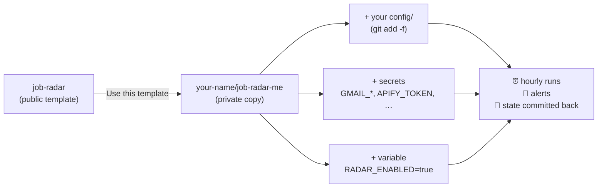

# Deployment

This guide takes you from nothing to hourly email alerts. It takes about 15 minutes.

- [Overview](#overview)
- [1. Create a Gmail App Password](#1-create-a-gmail-app-password)
- [2. Run locally first](#2-run-locally-first)
- [3. Create your private copy on GitHub](#3-create-your-private-copy-on-github)
- [4. Add secrets and turn it on](#4-add-secrets-and-turn-it-on)
- [5. First run and checks](#5-first-run-and-checks)
- [Optional: LinkedIn/Indeed (Apify)](#optional-linkedinindeed-apify)
- [Optional: AI notes (Claude)](#optional-ai-notes-claude)
- [Alternative: run on your own computer](#alternative-run-on-your-own-computer)
- [Updating from the template](#updating-from-the-template)
- [Pausing or stopping](#pausing-or-stopping)

## Overview



**Why two repositories?** The public template holds only code and docs. Your private copy holds your profile, the companies you watch, and your scan history. The template's `.gitignore` keeps personal files out, and the scheduled workflow does nothing until you set `RADAR_ENABLED=true`.

## 1. Create a Gmail App Password

job-radar sends email through Gmail with an **App Password**, a separate 16-character password that only works for this app and can be revoked at any time. Your normal password is never used.

1. Go to <https://myaccount.google.com/security>.
2. Turn on **2-Step Verification** if it's off (App Passwords require it).
3. Open <https://myaccount.google.com/apppasswords>.
4. Name it `job-radar` and click **Create**.
5. Copy the 16-character password (spaces don't matter). You won't see it again.

> Using a Google Workspace (work/school) account? Your admin may have disabled App Passwords. Use a personal Gmail account as the sender; alerts can still go to any address through `ALERT_TO`.

## 2. Run locally first

```bash
git clone https://github.com/Yogananda16/job-radar.git
cd job-radar
npm install
cp config/profile.example.yml config/profile.yml
cp config/portals.example.yml config/portals.yml
cp .env.example .env
```

Edit `config/profile.yml` (roles, skills, eligibility; see [CONFIGURATION.md](CONFIGURATION.md)), then put your Gmail details in `.env`:

```bash
GMAIL_USER=you@gmail.com
GMAIL_APP_PASSWORD=<your-16-char-app-password>
```

Check everything:

```bash
npm test                          # ~200 offline tests
npm run scan -- --no-apify --dry-run
npm run test-email                # sample alert lands in your inbox
npm run alert -- --dry-run        # real scan, prints the email it would send
```

## 3. Create your private copy on GitHub

1. Open the template repository and click **Use this template → Create a new repository**.
2. Name it, e.g. `job-radar-me`, and choose **Private**.
3. Clone it and copy your config in:

```bash
git clone https://github.com/<you>/job-radar-me.git
cd job-radar-me
cp ../job-radar/config/profile.yml ../job-radar/config/portals.yml config/

# config/ files are git-ignored on purpose; add them explicitly in your private copy
git add -f config/profile.yml config/portals.yml
git commit -m "Add my profile"
git push
```

Never do this in a public repository. Your profile describes your job search.

> **Optional:** to carry over first-seen history from an earlier setup, copy `job-seen.json` into `state/` and `git add -f state/job-seen.json`.

## 4. Add secrets and turn it on

In your private repository, go to **Settings → Secrets and variables → Actions**.

**Secrets** tab → **New repository secret**:

| Name | Value | Required |
|---|---|---|
| `GMAIL_USER` | your Gmail address | yes |
| `GMAIL_APP_PASSWORD` | the App Password from step 1 | yes |
| `ALERT_TO` | where alerts go (if not `GMAIL_USER`) | no |
| `APIFY_TOKEN` | see [Apify](#optional-linkedinindeed-apify) | no |
| `ANTHROPIC_API_KEY` | see [AI notes](#optional-ai-notes-claude) | no |

**Variables** tab → **New repository variable**:

| Name | Value |
|---|---|
| `RADAR_ENABLED` | `true` |

Or, with the GitHub CLI:

```bash
gh secret set GMAIL_USER --body "you@gmail.com"
gh secret set GMAIL_APP_PASSWORD          # paste when prompted, so it isn't saved in shell history
gh variable set RADAR_ENABLED --body true
```

**Workflow permissions:** the workflow commits `state/` back, so it needs write access. This is usually the default; if the first run fails at "Save state" with a 403, go to **Settings → Actions → General → Workflow permissions** and choose **Read and write permissions**.

## 5. First run and checks

1. **Actions** tab → **scan** → **Run workflow** (leave Apify unchecked) → **Run workflow**.
2. Open the run. The **Scan and alert** step prints a line like:
   `[job-radar] scan 34.2s · found 3 · alerting 3 · apify $0 · email sent`
3. The run's **Summary** page lists the jobs.
4. Check your inbox, and the repository for a `chore(state): scan …` commit.

From now on, the schedule runs it automatically:

| Schedule (UTC) | Eastern time (EDT) | Sources | Cost |
|---|---|---|---|
| `:07` every hour | every hour | employer boards + free public boards | $0 |
| `:37` at 13, 17, 21 | 9:37 am, 1:37 pm, 5:37 pm | + LinkedIn/Indeed (if `APIFY_TOKEN` is set) | ≤ $0.10 each |

Cron times are UTC, so in winter (EST) the paid runs happen an hour earlier. Edit `.github/workflows/scan.yml` to change times. GitHub may delay scheduled runs by a few minutes at busy times.

**Failure notifications:** GitHub emails you when a scheduled run fails (Settings → Notifications → Actions).

## Optional: LinkedIn/Indeed (Apify)

LinkedIn and Indeed find jobs at companies you don't track. Their results are still verified at the employer before you see them.

1. Create an account at <https://apify.com> (the free plan includes monthly credit).
2. **Settings → API & Integrations → Personal API tokens** → copy the token.
3. Add it as the `APIFY_TOKEN` secret (and in `.env` for local runs).

Spend is capped at $0.10 per scan by default ($0.25 hard maximum) and enforced by Apify itself. At 3 runs a day that's at most about $9/month; typical use is about $5. See [COST.md](COST.md).

## Optional: AI notes (Claude)

1. Create an API key at <https://console.anthropic.com> → **API Keys**.
2. Add it as the `ANTHROPIC_API_KEY` secret.
3. Pick the model in `profile.yml → ai.model` (`claude-opus-5-5` by default; `claude-haiku-5-5` is about 40× cheaper).

Each alert email then shows a "✅ fit / ⚠️ gap" line per job. If the key is missing or the API fails, the email goes out without notes.

## Alternative: run on your own computer

If you'd rather not use GitHub Actions, schedule `npm run alert` locally. The computer must be on and awake.

**Windows (Task Scheduler)**

```powershell
$action  = New-ScheduledTaskAction -Execute "node" -Argument "src\main.mjs" -WorkingDirectory "D:\Projects\job-radar"
$trigger = New-ScheduledTaskTrigger -Once -At (Get-Date) -RepetitionInterval (New-TimeSpan -Hours 1)
Register-ScheduledTask -TaskName "job-radar" -Action $action -Trigger $trigger -Description "Hourly job alerts"
```

For the 3-times-a-day Apify runs, create a second task with `-Argument "src\main.mjs --apify"` and daily triggers at 9:37, 13:37 and 17:37.

**macOS / Linux (cron)**

```cron
7 * * * *         cd /path/to/job-radar && /usr/bin/env node src/main.mjs >> output/cron.log 2>&1
37 9,13,17 * * *  cd /path/to/job-radar && /usr/bin/env node src/main.mjs --apify >> output/cron.log 2>&1
```

Local runs keep state in `state/` on disk, so there's nothing to commit.

## Updating from the template

Your private copy doesn't update automatically. To pull in new versions:

```bash
git remote add template https://github.com/Yogananda16/job-radar.git   # once
git fetch template
git merge template/main --allow-unrelated-histories   # first time only needs the flag
npm install
npm test
git push
```

Your `config/` and `state/` files are untouched because the template never contains them.

## Pausing or stopping

| Goal | How |
|---|---|
| Pause alerts | Set `RADAR_ENABLED` to `false`, or **Actions → scan → ⋯ → Disable workflow** |
| Stop paid scans only | Delete the `APIFY_TOKEN` secret |
| Stop AI notes | Delete `ANTHROPIC_API_KEY` or set `ai.enabled: false` |
| Revoke email access | Delete the App Password at <https://myaccount.google.com/apppasswords> |
| Forget seen jobs | Delete `state/job-seen.json` and commit (everything current becomes "new" once) |
