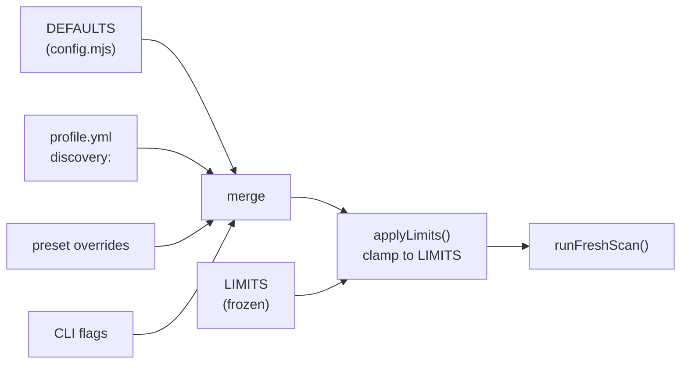

# Guardrails

job-radar runs unattended, 24 times a day, sometimes spending money. Every limit below is enforced in code, covered by tests, and **cannot be raised by configuration**. `profile.yml` and presets can only make a scan smaller, shorter or cheaper.

- [How limits are enforced](#how-limits-are-enforced)
- [Time](#time-guardrails)
- [Cost](#cost-guardrails)
- [Load and concurrency](#load-and-concurrency-guardrails)
- [Correctness](#correctness-guardrails)
- [Eligibility](#eligibility-guardrails)
- [Security and privacy](#security-and-privacy-guardrails)
- [Agents (MCP)](#agent-guardrails-mcp)
- [Failure behavior](#failure-behavior)

## How limits are enforced

`LIMITS` is a frozen object in `src/engine/config.mjs`. `applyLimits()` runs **last**, after every other source of configuration, and clamps each value. A test (`every preset keeps every guardrail`) checks all presets against it.

## Time guardrails

| Limit | Value | What happens when it's reached |
|---|---|---|
| Source budget | 90 s | All sources stop; the pipeline continues with what was collected |
| Soft limit | 3 min (max) | No new work starts; the scan returns the best result so far, marked **partial** |
| Hard limit | 5 min (max) | Every in-flight request is aborted; the scan returns immediately |
| Per request | 8 s (max) | Request aborted, counted as a timeout for that board |
| Per board | 20 s (default) | Board abandoned, counted as a failure |
| Apify run | 75 s (default, ≤ soft limit) | Run aborted through the Apify API |
| Process backstop | hard limit + 10 s (`cli.mjs`), 7 min (`main.mjs`) | Process exits with code 4 |
| GitHub job | 10 min | GitHub cancels the job |

Nothing outlives the process: no background jobs, no detached children. The timers are cleared when the scan returns.

## Cost guardrails

| Limit | Value | Enforced by |
|---|---|---|
| Apify spend per scan | $0.10 default, **$0.25 maximum** | Code: a ledger reserves each run's cap before it starts, and refuses runs that would exceed the scan cap |
| Apify spend per run | $0.01 default (≤ scan cap) | Apify server: `maxTotalChargeUsd` on every run |
| Apify warning | $0.08 | Shown in the report |
| Results per Apify query | ≤ 50 | Clamp |
| Paid scans per day | 3 (schedule) | `scan.yml` cron; hourly runs set `RADAR_APIFY=0` |
| AI notes per alert | 1 request, ≤ 10 jobs, ≤ 6,000 characters of job text each | `src/ai/summarize.mjs` |

Actual Apify cost is read back from each run's charged events (exact), not estimated. If the read-back lags, it is retried, and the reservation floor (items × price + start fee) is used.

## Load and concurrency guardrails

| Limit | Value |
|---|---|
| Source workers in parallel | **3** (extra enabled sources are switched off by the clamp) |
| Concurrent HTTP requests | ≤ 8 |
| Concurrent Apify runs | ≤ 6 |
| Rotating public boards per scan | ≤ 50 (25 default) |
| Job-text fetches per scan | ≤ 25 |
| Shortlist verified at employers | ≤ 15 |
| Results | ≤ 10 |
| Scheduled runs at once | 1 (`concurrency: scan`) |

Boards that failed 3+ times are skipped for 30 days (`state/dead-boards.tsv`), so the scanner doesn't keep hitting dead endpoints. Requests identify job-radar in the User-Agent.

## Correctness guardrails

### The strict final gate

A job reaches the results **only if all of these hold** (`finalGateReason()` in `run.mjs`):

1. **NEW:** the employer's own system says it was first posted ≤ 24 h ago, and job-radar has never seen it before.
2. **Live:** it was listed on, or opened from, the employer's ATS during this scan, and the posting isn't closed.
3. **Official link:** the apply URL is on the employer's ATS or careers site, never an aggregator.
4. **Not BLOCKED** by the eligibility gate.

Everything else is excluded and counted by reason: `seen before`, `possible repost`, `original freshness unverifiable`, `older than 24h`, `closed at employer`, `no live employer page verified`, `aggregator-only apply link`, `eligibility blocked`. **The Top 10 is never padded** with jobs that fail the gate.

### Freshness rules

| Evidence | Rule |
|---|---|
| Exact employer timestamp | NEW only if ≤ 24 h old |
| Employer gives only a date | NEW only if that date is **today** (local calendar) |
| Yesterday's date, no time | Excluded (can't prove ≤ 24 h) |
| LinkedIn/Indeed "posted X ago" | Never enough on its own → VERIFY |
| Fresh listing + older employer date | POSSIBLE_REPOST |
| Anything in the first-seen store | SEEN, whatever a source displays now |

### Identity and repost detection

A job is "the same job" if any of these match a stored record: source id, canonical URL, requisition number, company + title + location, or a text fingerprint with similarity ≥ 0.92 (repost). Requisition numbers from Workday, SmartRecruiters and Indeed join the identity, so a re-released requisition is caught.

### Employer matching

When a LinkedIn/Indeed job is looked up at the employer:

- the employer name must match (prefix or acronym matches need confirmation from the ATS's own `hiringOrganization`);
- title similarity must be ≥ 0.8, with identical seniority words ("II", "Senior");
- the location must be compatible;
- two equally good candidate postings means **ambiguous → reject**.

Oracle sites are matched only from configured `companyBoards` or tracked entries, never guessed. A missing employer name ("Confidential") is excluded as `employer hidden`, never inferred.

## Eligibility guardrails

The gate returns **BLOCKED** (never shown), **VERIFY** (shown, flagged for you to read) or **OK**. Every finding carries the quoted sentence that triggered it.

| Rule group | BLOCKED when the text says… | VERIFY when… | Turned off by |
|---|---|---|---|
| Sponsorship | "no sponsorship now or in the future", "must never require sponsorship" | vaguer wording ("unable to sponsor") | `needs_sponsorship: false` |
| Citizenship / clearance | "US citizens only", "Green Card holders only", clearance *requiring* citizenship | clearance or polygraph with citizenship unstated; public trust | `us_citizen: true` |
| OPT | excludes OPT / CPT / STEM OPT | — | `on_opt: false` |
| Enrollment | "must be currently enrolled" | — | `graduated: false` |
| Graduation | requires graduating after your `graduation` date | — | `graduation: none` |
| Experience | asks for more than `max_years_required` years | — | raise the number |
| Salary | stated maximum below `salary_floor_k` | — | lower the number |
| Seniority | title has an excluded word (Staff, Principal, Director, Manager…) | — | `excluded_title_words` |
| Relocation | "local candidates only", "no relocation" | — | `block_local_only: false` |
| Labor certification | PERM / labor-certification notices (not real openings) | — | always on |
| No job text | — | job text missing or < 200 characters | — |

Known boilerplate is excluded from matching (for example, the "Employee Polygraph Protection Act" legal notice and "citizen status" in EEO statements), and each exception has a regression test.

## Security and privacy guardrails

- **Secrets** come only from environment variables (`.env` locally, GitHub secrets in Actions). `.env` is git-ignored. `npm run check:secrets` scans every tracked file for token patterns and runs in CI.
- **Personal files** (`config/profile.yml`, `portals.yml`, `cv.md`, `blacklist.md`, `state/`) are git-ignored in the template. Your private copy adds them explicitly with `git add -f`.
- **Outbound URLs** built from external data (board lists, job links) are checked against the expected ATS host before any request (SSRF guard), and provider requests go through an IP guard that refuses private and loopback addresses.
- **Job postings are untrusted data.** They never control program flow, and the AI prompt tells the model to ignore instructions inside postings. The model's output is schema-validated and only ever displayed as text.
- **Least privilege in CI:** `ci.yml` has read-only permissions; `scan.yml` has `contents: write` only to commit `state/`.

## Agent guardrails (MCP)

- An agent cannot start paid scans unless the server was started with `RADAR_MCP_ALLOW_APIFY=1` **and** the call sets `include_apify: true`.
- `run_scan` is a dry run by default, so exploring doesn't use up your alerts.
- `check_job_link` refuses aggregator links and reads only employer ATS APIs.
- The server never sends email and never applies.

## Failure behavior

| Failure | Behavior | Exit code |
|---|---|---|
| A board times out or errors | Counted in "Board failures", scan continues | 0 |
| A whole source fails | Recorded in `sources`, other sources continue | 0 |
| `APIFY_TOKEN` missing | Apify skipped with instructions; free sources still run | 0 |
| Apify cap reached | Remaining runs not started; partial Apify results kept | 0 |
| Soft / hard time limit | Partial result, clearly marked | 0 |
| `ANTHROPIC_API_KEY` missing, AI error or refusal | Email sent without AI notes | 0 |
| Gmail not configured or send fails | Jobs kept as **pending**, retried next run | 2 |
| Scan crashes | Error logged; state not written | 1 |
| Bad command-line flag | Usage printed | 3 |
| Process backstop | Forced exit | 4 |
